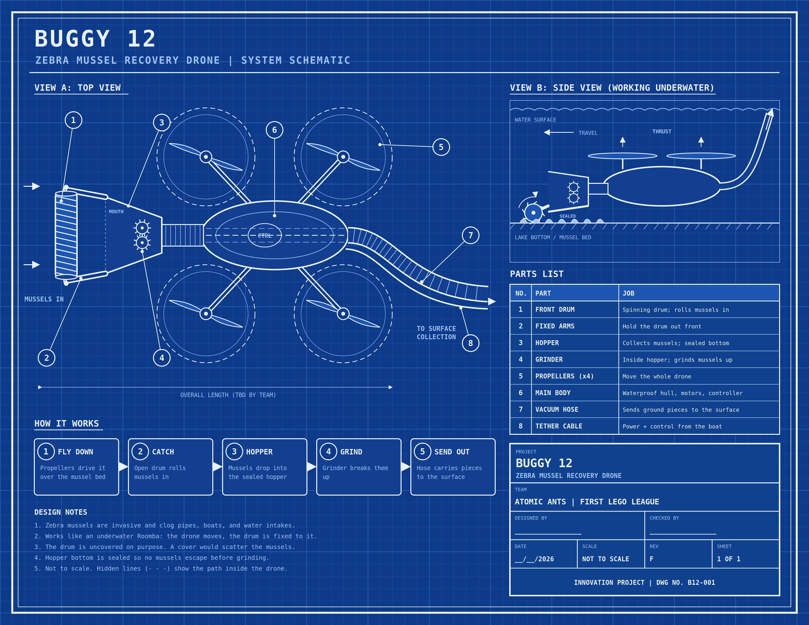
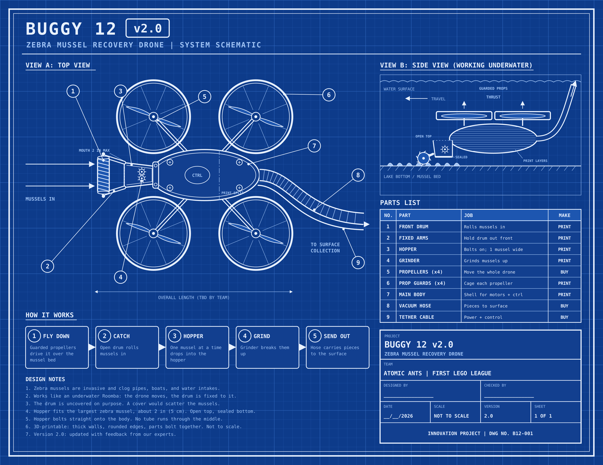

Buggy 12 is our zebra mussel recovery drone. Zebra mussels are invasive and clog
pipes, boats, and water intakes. Here are our blueprints for version 1 and version 2.

## Version 1

## Version 2

Version 2.0 was updated with feedback from our experts. It adds a guard around each
propeller, and the hopper now bolts straight onto the body.

